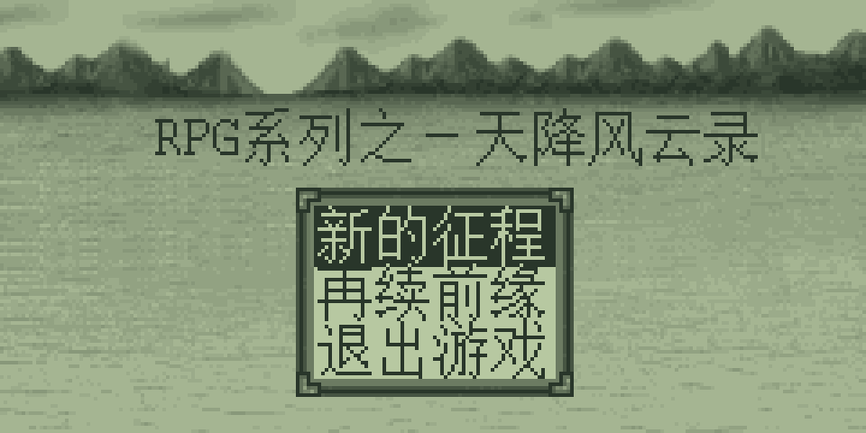
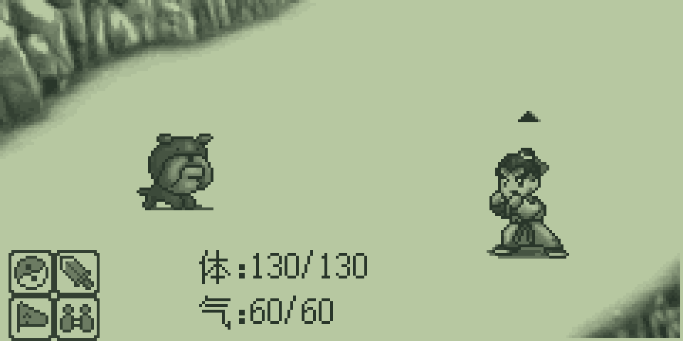

# 诺亚舟-NPE-引擎

纯 C11 + SDL2 实现的独立 NPE 游戏运行程序。直接读取游戏资源；运行时不依赖 DMCU 模拟器、PRG 固件。

当前为开发版。已实现地图、剧情、战斗、人物与装备、商店、自身三槽存档、音频播放和手柄输入；完整跨游戏兼容仍在完善。最新状态见 [plan.md](plan.md)。

## 下载与使用

在 [GitHub Releases](https://github.com/HelloClyde/noah-npe-engine/releases) 下载 Windows x64 便携包，解压后双击 `npe-sdl.exe` 选择游戏，或将 `.npe` 文件拖到 EXE 上。保留 `assets` 和 `SDL2.dll`。

支持键盘和标准手柄；手柄 Start 打开按键说明。游戏文件需自行提供。

## 游戏截图

以下为当前 C＋SDL 程序实际渲染的《天降风云 V1.3》画面。战斗图通过内置战斗预览入口获取。

### 标题



### 地图


### 战斗



## 构建

需要 C11 编译器、CMake 和 SDL2 开发包。Windows 可使用 MSYS2 UCRT64 的 GCC、CMake 和 SDL2。

```sh
cmake -S npe-sdl -B build -DBUILD_TESTING=OFF -DCMAKE_BUILD_TYPE=Release
cmake --build build --parallel
cmake --install build --prefix dist
```

Windows 使用 MinGW 时可添加 `-G "MinGW Makefiles"`，必要时用 `-DSDL2_DIR=...` 指定 SDL2 CMake 配置目录。

```sh
./dist/npe-sdl path/to/game.npe
```

Windows 双击 `npe-sdl.exe` 可通过文件选择框打开游戏，也可将 NPE 文件拖到 EXE 上启动。安装目录需保留 `assets` 和 SDL2 运行库。完整键盘、手柄与存档说明见 [操作说明](npe-sdl/PORTABLE.md)。

## 测试与参考

`npe-sdl/tests` 保留开发测试源码。部分原版对照测试依赖本地游戏、固件及 `tmp` 中的参考数据，这些数据未纳入仓库；不能把完整测试集视为开箱即跑。

不依赖游戏资源的手柄检查可单独执行：

```sh
cmake -S npe-sdl -B build-tests -DBUILD_TESTING=ON
cmake --build build-tests --target controller-input-probe
ctest --test-dir build-tests -R controller-input --output-on-failure
```

## 资源

游戏 NPE、原机固件及个人存档不包含在仓库内。字体来源及使用说明见
[字体来源](npe-sdl/assets/FONT-PROVENANCE.txt) 和 [原字体许可文件](npe-sdl/assets/FONT-LICENSE.txt)。
SDL2 许可证见 [SDL2-LICENSE.txt](npe-sdl/third-party/SDL2-LICENSE.txt)。

## 许可证

本项目原创引擎、前端、工具及测试源码采用 **GNU General Public License version 2 only**
（SPDX：`GPL-2.0-only`），完整文本见 [LICENSE](LICENSE)。

第三方库、字体、游戏画面和原机资源不因源码采用 GPL-2.0 而改变各自授权。
当前原生字体的来源、历史 OFL 文件适用范围及其他资源说明见 [NOTICE](NOTICE.md)。

## 致谢

感谢 [NoahWiki](https://noahwiki.purelind.com/) 提供诺亚舟游戏资料、攻略和在线运行参考，为本引擎的开发与行为核对提供了帮助。

相关项目：[np560-plus-emulator](https://github.com/HelloClyde/np560-plus-emulator)，诺亚舟 NP560+ 模拟器。
