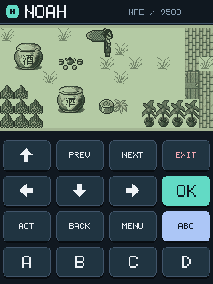
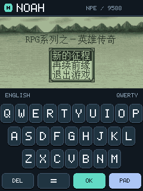
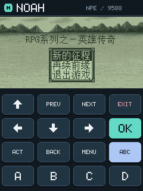

# BBK9588-noah-npe-engine

Noah NPE 引擎的步步高 BBK 9588 原生 BDA 移植版。读取游戏资源，复用上游 C 引擎；
在 240×320 屏幕上保留 240×120 游戏像素比例，配有圆角操作面板和 QWERTY 软键盘。
当前版本为 `0.1.0-alpha.1`。

**许可范围：只有 9588 移植层采用 MIT；上游引擎没有开源许可证，原机字库许可状态保持原样。**
详见 [来源与许可范围](SOURCE_NOTICE.md)，不要将整个项目视为 MIT 软件。

## 快速开始

成品入口：[GitHub Releases](https://github.com/HelloClyde/BBK9588-noah-npe-engine/releases)。
若尚无已发布版本，可按下方命令自行构建。

1. 下载并解压 `NPE9588-install.zip`。
2. 将 `NPE9588.bda` 复制到 BBK 9588 的应用目录，例如 `A:\应用\程序\`。
3. 将安装包中的整个 `NPE` 文件夹复制到 A 盘根目录，保留
   `A:\NPE\assets\gbk12-native.bin` 和 `gbk16-native.bin`。
4. 自行提供游戏 `.npe` 文件，可放在 `A:\NPE\`。从设备应用入口启动 NPE9588，
   在文件选择器中打开游戏。

方向键移动，OK 确认，ACT 动作，BACK/MENU 打开或关闭菜单，PREV/NEXT 翻页，EXIT 退出。
ABC 切换英文键盘，PAD 返回操作面板；A/B/C/D 用于答题，装备页 U 用于卸下装备。
三个存档槽自动保存到 `A:\NPE\saves\`；退出日志为 `A:\NPE\NPE.LOG`。

开发者构建（Windows PowerShell，Python 3.10+）：

```powershell
git clone https://github.com/HelloClyde/BBK9588-noah-npe-engine.git
cd BBK9588-noah-npe-engine
git submodule update --init sdk
./sdk/scripts/setup_toolchain.ps1
python bbk9588/build.py
python bbk9588/check_package.py
```

SDK 的嵌套模拟器子模块不参与构建，无需递归下载。输出：
`dist/bbk9588/NPE9588.bda`、`dist/NPE9588-install.zip`、`dist/SHA256SUMS.txt`。
已有兼容工具链时，可用 `BDA_TOOLCHAIN_PREFIX` 环境变量或 `--prefix` 指定前缀。
构建脚本会核对 SDK 提交，拒绝使用修改过的 SDK 头文件/打包器。

## 截图

以下均为 `bbk9588-emulator-v0.1.5` 中实际运行《英雄传奇》的截图，非效果图。

| 地图与操作面板 | 英文软键盘 |
| --- | --- |
|  |  |



## 依赖

- 成品运行：BBK 9588 BDA 环境、安装包中两份原机中文字库、用户提供的 NPE 游戏。
  不需要 SDL2 DLL、PC 主机程序或原机 NP560 固件。
- SDK：[bbk9588-bda-sdk](https://github.com/HelloClyde/bbk9588-bda-sdk)，
  子模块固定 `9c4cc3333e9e959f70797d2bcdc1d0760ddb4471`，包含全局文件刷新 API。
- 开发构建：Windows、Git、Python 3.10+ 标准库、MIPS GCC 15.2.0。
  SDK 安装脚本对工具链压缩包核对 SHA-256
  `8ba866e25c9826ee04ab4310365d264e3e73769e3738bb58ae38fd6740b7ee8d`。
  Actions 使用 Python 3.12；不需要安装 SDL2 或其他 Python 库。
- 字体：直接使用上游固定的生成表，不在普通构建中重新生成。
  原机字库再生需要用户自行提供匹配的 NP560 V3.80 PRG/NAND 资源，工具及输入散列
  见 [字体来源](npe-sdl/assets/FONT-PROVENANCE.txt)。这些原始资源不随仓库分发。
- 可选动态验证：`bbk9588-emulator-v0.1.5` 和专用 NAND 副本。
  运行方式见 [9588 开发说明](bbk9588/README.md)。

## 验证与发布

已在模拟器验证启动、地图移动、英文键盘、触屏菜单、实际音频、三槽界面的两个存档槽、
读档恢复以及退出后继续游戏。读档后重新保存的完整存档 SHA-256 与首次保存一致。
尚未做真机验证或完整通关；上游跨游戏兼容仍在完善。
[验证记录](bbk9588/qa/VERIFICATION.md) 包含运行范围、截图及 BDA SHA-256。

`main`、PR 和手动触发执行构建、BDA 静态校验和安装包校验，上传临时 artifacts。
`v*` 标签须匹配 `VERSION`，成功构建后发布同一批 BDA、安装包和散列清单。
预发布版本带 `alpha` 标记。CI 不运行含固件/游戏资源的模拟器测试。

## 感谢

感谢 [HelloClyde/noah-npe-engine](https://github.com/HelloClyde/noah-npe-engine)
提供 NPE 解析、游戏逻辑、界面、音频与存档实现；本移植保留其源码和历史，基线为
`942b645ba26693db43c32375f28d53d32d1da099`。
感谢 [bbk9588-bda-sdk](https://github.com/HelloClyde/bbk9588-bda-sdk) 的公开 API、
工具链安装与 BDA 打包校验工具。
沿用上游致谢：感谢 [NoahWiki](https://noahwiki.purelind.com/) 提供诺亚舟游戏资料、
攻略和在线运行参考。相关项目：
[np560-plus-emulator](https://github.com/HelloClyde/np560-plus-emulator)。

原桌面构建和上游说明保留在 [README-upstream.md](README-upstream.md)。
